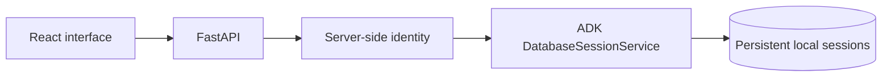

# Google ADK E2E Agent Suite

Assignment 3: five independently runnable ADK applications with authenticated
sessions, a shared React interface, reproducible checks and evidence of live
integrations. Implementation follows the supplied master prompt's strict gates.

**Current scope:** foundation implementation and verification. No completed agent,
live model execution, cloud deployment or public GitHub submission is claimed.

| Part | Intended capability | Status |
|---|---|---|
| A | Evidence-backed lead research and export | Not started |
| B | Real Gemini CLI tool in an ADK pipeline | Not started |
| C | MCP issue investigation | Not started |
| D | Grounded code review and isolated tests | Not started |
| E | Shopify catalog, AlloyDB/Toolbox and checkout | Not started |

## Local foundation

Use Python 3.12.14, uv 0.12.10 and Node 24.22.1 (see version files).

```sh
make setup
make check
make run-api
# In a second terminal:
make run-web
```

Open http://127.0.0.1:5173. The UI shows actual missing configuration. To exercise
session creation, set LOCAL_ACCESS_TOKEN in the root `.env` to at least 32 random
characters and restart the API. Keep it private and enter it in the page's password
field. Empty .env files are created locally and ignored by Git. Never put secrets
in a VITE_ variable or commit a .env file.



[Setup](docs/setup.md) · [Milestones](docs/milestones.md) ·
[Technical decisions](docs/technical-decisions.md) · [Security](docs/security.md) ·
[References](docs/references.md) · [Submission](docs/submission.md)

GitHub URL: not published. Deployment URL: not deployed.
[YouTube slots](docs/videos/README.md): all pending user recording/upload.
`make verify-all` will be added only when all five real verification paths exist;
`make check` currently checks the foundation only.
