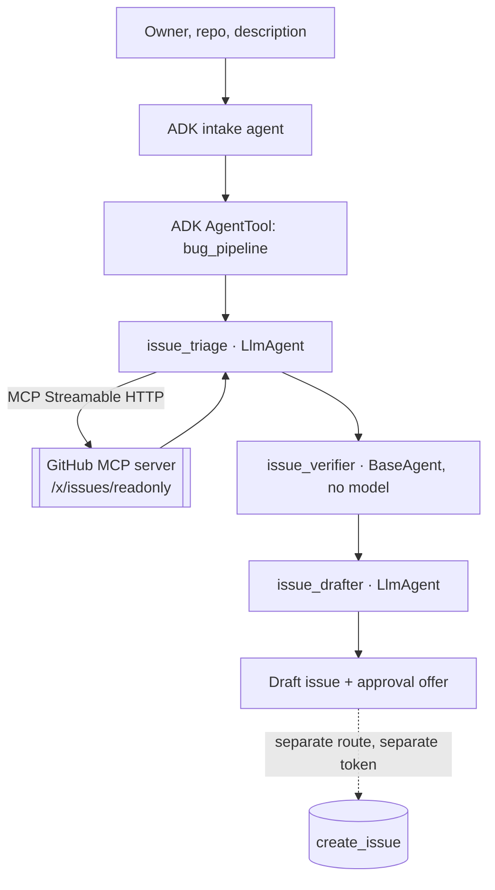

# C — MCP software bug assistant

Triage a reported bug against the real issues in an allowlisted GitHub repository over
a genuine MCP connection, verify every duplicate claim against the issues actually
retrieved, and offer to file an issue only behind an approval bound to its exact content.

**C1 and C2 are PASSED and live-verified.** The connection is ADK's `McpToolset` over
Streamable HTTP to the official remote GitHub MCP server. Nothing here calls the GitHub
REST API directly and labels it MCP.



## Transport, credentials and scope

| Item | Value |
|---|---|
| Transport | Streamable HTTP (`StreamableHTTPConnectionParams`) |
| Endpoint | `https://api.githubcopilot.com/mcp/x/issues/readonly` |
| Read credential | Fine-grained PAT, read-only Issues on the allowlisted repos |
| Enabled tools | `search_issues`, `list_issues`, `issue_read`, `get_label`, `list_issue_fields`, `list_issue_types` |
| Write credential | A second token, only when `GITHUB_WRITE_ENABLED=true` |
| Write endpoint | `https://api.githubcopilot.com/mcp/x/issues` (no `/readonly`) |

Credentials live in `agents/bug_assistant/.env`, not the shared root file. `BugSettings`
reads root then the component file, with the component winning, so shared values such as
the model still come from root while the token stays local to Part C.

Read scope is enforced three times, because one layer is not a boundary: the URL must be
a `/readonly` path (a default or `/x/all` URL is refused), `X-MCP-Readonly: true` is also
sent, and advertised tools are filtered against an allowlist with any name containing a
write marker aborting the connection outright.

## Setup and commands

```sh
# agents/bug_assistant/.env
GITHUB_TOKEN=<fine-grained PAT, read-only Issues>
GITHUB_ALLOWED_REPOSITORIES=owner/repo,another/repo

make preflight-bug                       # configuration only, no network
make verify-bug                          # real handshake, tools list and one lookup
make verify-triage BUG_REPO=owner/repo    # a full triage pass, writes evidence
make run-api && make run-web             # then pick "C · MCP bug assistance"
```

## HTTP interface

| Method | Path | Purpose |
|---|---|---|
| `POST` | `/api/agents/bug_assistant/{session_id}/triage` | Read-only triage; returns a draft and an approval offer |
| `POST` | `/api/agents/bug_assistant/{session_id}/create-issue` | The only mutating route in the suite |

Both require a bearer credential and derive ownership server-side, so another identity
receives `404` and a session belonging to a different agent is also `404`. Invalid input
is `422` before any MCP call.

## The write path

Creating an issue is the only irreversible action in Part C, so it is gated four ways:

1. `GITHUB_WRITE_ENABLED` must be explicitly true.
2. `GITHUB_WRITE_TOKEN` is a separate token; the read token is never used for a write.
3. The write endpoint is a separate, non-`/readonly` URL and must be on GitHub's host.
4. A single-use approval grant is minted from the preview and bound to the **SHA-256 of
   the exact content** plus the repository and the user. Editing one character of the
   approved issue invalidates it, as does replaying it, letting it expire, or presenting
   it as a different user.

An approval offer is not a permission. A write is never claimed without the provider's
own issue number and URL in the response.

## Example inputs

- `google` / `adk-python` — "Session identity components are not validated before being used as document path segments, so a user_id containing a slash nests one identity's session under another."
- `google` / `adk-python` — "Streaming responses drop the final chunk when the client disconnects mid-turn."
- Your own repository with a real defect you have observed.

## Verification status

`implemented`, `tested locally`, `live-service verified`. Not `cloud-deployed`.

- 67 unit tests for this part; 190 across the repository.
- `docs/evidence/c1-mcp-gate.txt`: unconfigured preflight exits 2; configured,
  handshake in 1891 ms, 6 tools advertised and admitted with no write tool present,
  then a real lookup in 1220 ms.
- `docs/evidence/c2-triage-gate.txt` and `c2-api-e2e.txt`: a real triage returning
  `google/adk-python#7800` as a verified duplicate, independently confirmed with
  `gh issue view` as OPEN with the same title and URL.

Known limitations: the root cause is a hypothesis from the description and issue text,
not a diagnosis confirmed by running code, and every report says so. Duplicate matching
depends on the search terms the triage step chooses. No issue has been created by this
project in any repository.

YouTube video URL:
