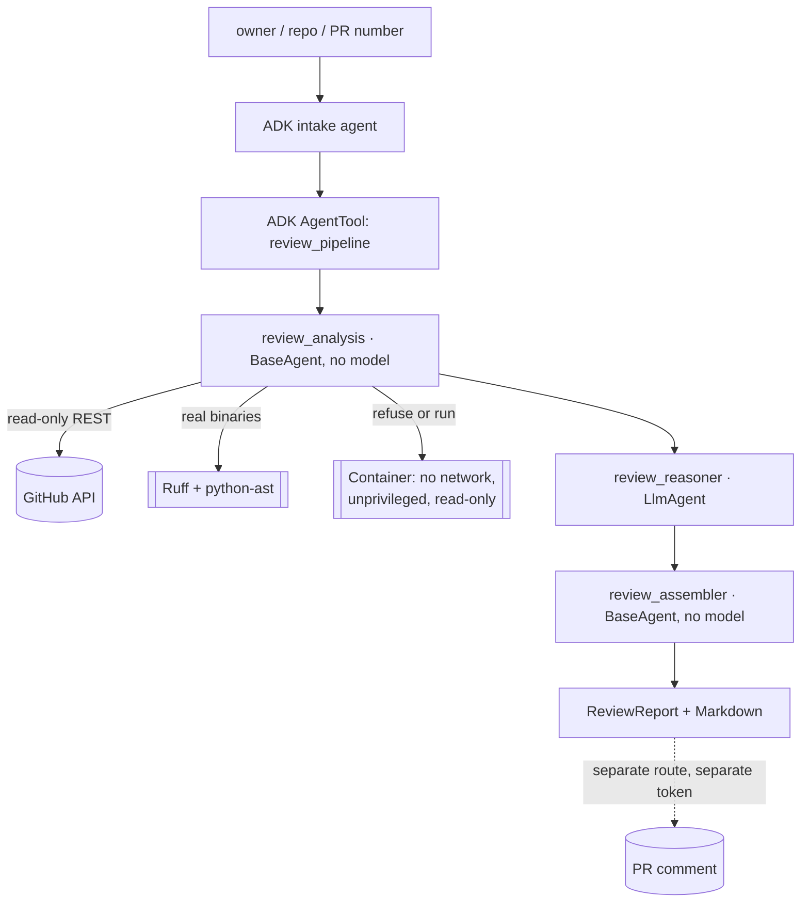

# D — Production-oriented code review assistant

Review a real GitHub pull request with deterministic analysis and ADK synthesis, where
every finding is attributed to a line the pull request actually changed, and posting a
comment is a separately authorized action.

**D1 and D2 are PASSED and live-verified.** Retrieval is read-only over GitHub's REST
API; Ruff and the Python AST parser really run; tests execute only inside a locked
container or are reported as `tests_not_run`.



Only `review_reasoner` is a model. Retrieval, diff mapping, tool execution, the sandbox
decision, deduplication, out-of-diff rejection and the blocking verdict are all plain
code, for the same reason Part A's ranker and Part B's grounding check are.

## What makes a finding admissible

`diff.py` parses the unified patch and tracks new-side line numbers, producing the hunk
ranges a comment may refer to. A comment naming a file the diff does not touch, or a
line outside a hunk, is **discarded** and counted. That is the difference between
"findings tied to a real file and line" as a claim and as a property.

Comments are then split: one matching a diagnostic that actually ran is **verified** and
carries its rule code; everything else is the reviewer's reading and is labelled
**unverified**. A blocking verdict requires a verified high-or-critical finding, or a
critical reading, so style alone can never request changes.

## Test execution, or an honest refusal

Running a pull request's tests means running a stranger's code. The sandbox is an
ephemeral container with `--network none`, UID 65534, a read-only root filesystem, a
read-only project bind mount, a `noexec,nosuid` tmpfs for scratch, 512 MB memory, one
CPU, 128 PIDs, every capability dropped and `no-new-privileges`.

Two deliberate policies:

- **Executing a pull request's tests is refused by default.** The container is a strong
  boundary, not an unbreakable one. The status is `tests_not_run` with that reason, and
  the isolation controls are still reported so a reader sees what would have applied.
- The sandbox has no network, so third-party packages cannot be installed. Suites are
  run with stdlib `unittest`; one importing external packages is `tests_not_run` with
  that reason rather than half-run.

Nine live tests prove the isolation by trying to violate it: reaching the internet,
becoming root and writing to the project mount all fail inside the container.

## Setup and commands

```sh
# agents/code_reviewer/.env
GITHUB_TOKEN=<fine-grained PAT, read Pull Requests + Contents>
GITHUB_ALLOWED_REPOSITORIES=owner/repo

make preflight-review                               # tools and allowlist, no network
make verify-review PR=owner/repo#123                # D1: retrieval, mapping, analysis
make verify-review-pipeline PR=owner/repo#123       # D2: the full ADK pipeline
uv run pytest -m live tests/integration/test_sandbox_live.py   # sandbox isolation
make run-api && make run-web                        # then pick "D · Code review"
```

## HTTP interface

| Method | Path | Purpose |
|---|---|---|
| `POST` | `/api/agents/code_reviewer/{session_id}/review` | Read-only review; returns the report, its Markdown and a comment approval offer |
| `POST` | `/api/agents/code_reviewer/{session_id}/comment` | Posts one comment; never approves, never merges |

Both require a bearer credential and derive ownership server-side. A repository outside
the allowlist is `409`, invalid input is `422` before any network call, and an
unapproved post is `403`.

## Posting a comment

Gated like Part C's issue creation: `REVIEW_COMMENT_ENABLED` must be true,
`REVIEW_COMMENT_TOKEN` is a separate token, and a single-use grant is bound to the
SHA-256 of the exact comment text plus the repository, the pull request number and the
user. Editing one character invalidates it. The only verb used is posting one issue
comment on the thread; nothing approves or merges, and there is no auto-fix path.

## Example inputs

- `google` / `adk-python` / `7801`
- A pull request in your own repository, which is also the only safe target for a
  comment-posting demonstration.

## Verification status

`implemented`, `tested locally`, `live-service verified`. Not `cloud-deployed`.

- 87 unit tests for this part plus 9 live sandbox tests; 277 across the repository.
- `docs/evidence/d1-review-gate.txt`, `d2-review-gate.txt`, `d2-api-e2e.txt`,
  `d2-sandbox-gate.txt`, and the generated report at `d2-review-report.md`.

Known limitations: only Python has a configured analyser, and every other changed file
is listed as unanalysed rather than reviewed by assertion. No test suite has been
executed for a pull request, so no behavioural claim is made. Ruff runs `--isolated`, so
the reviewed project's own configuration cannot disable the checks that would flag it,
which also means its deliberate rule choices are not honoured. No comment has been
posted to any repository.

YouTube video URL:
