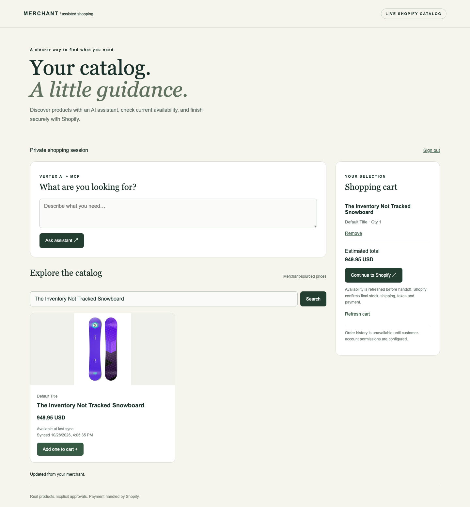

# Part E — ADK commerce with PostgreSQL, MCP and Shopify

The user approved replacing AlloyDB with **standard PostgreSQL on October 28, 2026**.
This is a documented departure from the local master prompt. The Canvas wording
requires an ADK ecommerce agent and links an AlloyDB tutorial as a hint; instructor
acceptance of the substitution has not been established. No AlloyDB deployment or
production cloud verification is claimed.

## What works

- Real authorized Shopify catalog import: 15 products / 24 variants at verification.
- PostgreSQL 17 persistent Docker volume, transactional source-ID upserts, inactive
  deletion handling, sync timestamps and indexed lexical search.
- Real MCP Toolbox 1.15.0 with two parameterized read-only catalog tools.
- Google ADK 2.13.0 with Gemini on Vertex AI through ADC; no AI Studio fallback.
- React/TypeScript storefront and FastAPI backend, per-user local token authentication,
  server-derived cart ownership, explicit action confirmations, idempotency records.
- Live Shopify availability, cart creation/add/remove, genuine hosted checkout URL.
- Real cross-user read/write denial and live Vertex tool execution evidence.

Checkout is a handoff: no card collection, order placement, payment success or
shipping status is fabricated. Exact inventory counts require an additional Shopify
scope; this implementation uses live `availableForSale` and Shopify mutation validation.
Order history explicitly reports BLOCKED until customer-account permissions exist.
The connected store contains demo-style product names. These are actual Shopify API
records, but production inventory provenance has not been independently verified.



## Start locally

Prerequisites: Python 3.12, uv, Docker Compose, Node 24, official MCP Toolbox 1.15.0,
and a Cloud project with Vertex access/ADC. All commands below start at repository root.

```sh
cd agents/ecommerce
uv sync --locked --python 3.12
cp -n .env.example .env
cd ../..
```

Fill the component `.env` with Vertex project/location/model, your authorized Shopify
store/token, and token type. Existing root Vertex settings are inherited. Authenticate
with `gcloud auth application-default login` if needed. Do not commit credentials.

```sh
agents/ecommerce/.venv/bin/python -m agents.ecommerce.runtime setup
agents/ecommerce/.venv/bin/python -m agents.ecommerce.cli sync
agents/ecommerce/.venv/bin/python -m agents.ecommerce.auth --name owner
npm --prefix agents/ecommerce/web ci
npm --prefix agents/ecommerce/web run build
```

In one terminal (substitute your downloaded binary's absolute path):

```sh
TOOLBOX_BINARY=/absolute/path/to/toolbox \
  agents/ecommerce/.venv/bin/python -m agents.ecommerce.runtime toolbox
```

In another terminal:

```sh
agents/ecommerce/.venv/bin/python -m uvicorn agents.ecommerce.server:app \
  --host 127.0.0.1 --port 8085 --no-access-log
```

Open http://127.0.0.1:8085 and use the credential stored in
`agents/ecommerce/.local/owner.token`. It stays in browser memory, not localStorage.
The token is a locally provisioned account credential, **not Google OAuth**.
The app intentionally rejects non-loopback Host headers and is not internet-ready.

## Verify

```sh
make -C agents/ecommerce check
agents/ecommerce/.venv/bin/python -m agents.ecommerce.cli shopify-check
agents/ecommerce/.venv/bin/python -m agents.ecommerce.cli probe
agents/ecommerce/.venv/bin/python -m agents.ecommerce.auth --name isolation-test
agents/ecommerce/.venv/bin/python -m agents.ecommerce.live_check
```

The live check uses real services and makes a billable Vertex request. Use the two
issued accounts only for this demonstration: the test adds/removes an item in their
carts. It does not purchase anything. Existing credentials are never overwritten;
skip issuance if their private files already exist. See WALKTHROUGH.md and DEMO.md
for browser checks, detailed code tour, limitations and video artifacts.

## Local lifecycle

Ctrl-C stops the API and MCP processes. Stop PostgreSQL while preserving data:

```sh
docker compose --project-name adk-ecommerce \
  --env-file agents/ecommerce/.local/postgres.env \
  -f agents/ecommerce/compose.yaml down
```

Only add `--volumes` if you deliberately want to delete the database. Keep `.local`
credentials with the volume; deleting only one makes reconnecting inconsistent.
No AlloyDB, Cloud SQL or Cloud Run resources were provisioned.
