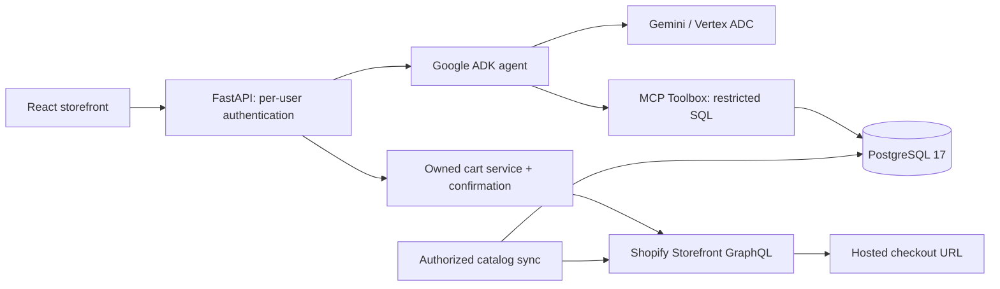

# Detailed code and execution walkthrough

## 1. Scope and architecture

The user explicitly approved PostgreSQL in place of AlloyDB on October 28, 2026.
The old cloud gate is superseded by a real PostgreSQL/MCP/Shopify gate. Original
AlloyDB YAML remains an unverified optional reference; it is not the runtime path.
All changes are under `agents/ecommerce` so Parts A–D remain independent.

## 2. Persistent infrastructure

`compose.yaml` pins PostgreSQL by digest and binds only 127.0.0.1:55432. The volume
survives restarts. `runtime.py setup` creates private local credential files, runs
migrations, and separates three roles: database owner for migrations, application
login for commerce/session data, and catalog reader for Toolbox. The app is not a
PostgreSQL superuser. ADK session tables live in its dedicated `adk_sessions` schema.

`001_catalog.sql` defines merchant product/variant keys, sync history, full-text GIN
index, authenticated subjects, cart mappings and audit events. `003_sessions.sql`
adds hashed access tokens and idempotency operations. `002_roles.sql` gives Toolbox
only product/variant SELECT, with no access to users or cart tokens.

## 3. Actual Shopify synchronization

`shopify.py` uses fixed authorized merchant HTTPS endpoints, Storefront 2026-10,
bounded paginated requests, safe retry rules, and typed source models. Product
and variant IDs, prices, images and availability come from the API. No seed rows
or fake provider implementations exist. `database.py` obtains a per-merchant lock,
fetches the complete source snapshot, upserts source IDs and marks disappeared rows
inactive in one transaction. A failed fetch rolls back. Network pagination is not
an atomic Shopify snapshot: concurrent merchant updates can require another sync.

`cli shopify-check` proves source connectivity without a database. `cli sync`
actually imports. Repeated syncs update the same source records; metadata records
are retained. Empty catalogs are valid and rendered honestly.

## 4. Real MCP and ADK

`infra/catalog-tools.yaml` contains `search_catalog` and `get_product_details` with
bound parameters and fixed merchant scope. `runtime.py toolbox` validates the
operator merchant before SQL configuration substitution, and restricts origin/host
access. MCP is private to the machine. `mcp_client.py` performs actual Streamable
HTTP MCP sessions, not a local function pretending to be MCP.

`agent.py` exports an ADK root agent using explicit Vertex project/location. The
authenticated API supplies the subject through a closure, not the prompt. Chat
may query live Shopify availability or read that subject's cart, but cannot mutate
anything. The prompt treats product text as untrusted, requires catalog evidence,
and directs users to confirmation controls. `server.py` persists ADK sessions in
PostgreSQL, caps a turn at six model calls and 90 seconds, and permits at most two
concurrent model requests. Responses expose tool names and final text, not hidden
reasoning or provider credentials. Chat currently starts a fresh session per turn.

## 5. Authentication and commerce ownership

`auth.py` issues independent cryptographically random local credentials and stores
only their SHA-256 hashes in PostgreSQL. Credential files are ignored and mode 0600.
Each credential maps to one server-side subject. Every cart lookup uses both local
cart UUID and authenticated subject plus merchant. The browser never gets Shopify's
secret cart ID. Tests use two genuinely issued credentials, not mocked identities.

This is appropriate for a local demonstration. Public production deployment needs
OIDC/account lifecycle, HTTPS, managed secrets, quotas, operational monitoring and
an explicit deployment review. Local bearer-token authentication must not be
presented as Google Sign-In. Token revocation is supported by the database `revoked`
flag; there is currently no account-management UI or automatic token expiry.

## 6. Confirmed Shopify operations

`models.Action` rejects extra fields, unconfirmed requests, invalid IDs and invalid
quantities. `commerce.py` serializes actions per user and persists a pending operation
before contacting Shopify. Successful repeated request IDs return the original
result; different payloads with the same ID are rejected. Shopify mutations are
never automatically retried. An interrupted/unknown result requires reconciliation
rather than a blind repeat; this favors duplicate prevention over automatic recovery.

The user confirms creation/add/remove/checkout through storefront controls. Before
adding and checkout, Shopify live availability is read. The current token lacks
`unauthenticated_read_product_inventory`, so exact quantities are not requested.
Shopify remains authoritative for stock enforcement, pricing and payment. The
checkout route retrieves a genuine HTTPS URL; the UI provides a deliberate external
link and does not visit or submit payment automatically. Cart responses are capped
at 100 lines; large carts fail explicitly instead of silently truncating.

The service does not expose order lookup without customer-account authorization.
Expired carts produce an explicit error and currently need operator-assisted reset.
There are no webhooks, background reconciliation jobs or payment-state claims.

## 7. Verification and evidence

`make check` performs lint, formatting, strict typing and pure contract tests.
`local_check.py` verifies real empty PostgreSQL/MCP plus denied table/mutation access.
`live_check.py` tests actual source rows, MCP search, authenticated carts, duplicate
requests, cross-user reads/writes, checkout URL retrieval, cleanup and Vertex calls.
It saves counts/booleans/tool names, not cart secrets or private catalog exports.

`web/browser-check.mjs` uses Playwright against the running app and actual Shopify.
It verifies search, confirmed add, checkout link, removal and clearing credentials
on sign-out, and captures desktop/mobile screenshots. It needs a private search
input in `.local/browser-query.txt` containing a title from the actual imported
catalog; no fake test products. Install Playwright Chromium before running it.

The local check, live check and browser check have different evidence files. Earlier
blocked evidence is historical, not the current gate. No test proves real payment,
production hosting, AlloyDB, or authorized order history.

## 8. References and version decisions

- [Original assignment codelab](https://codelabs.developers.google.com/codelabs/sports-agent-adk-mcp-alloydb)
- [Reference repository](https://github.com/mtoscano84/sports-agent-adk-mcp-alloydb/)
- [MCP Toolbox v1.15.0](https://github.com/googleapis/mcp-toolbox/tree/v1.15.0): flat
  kind/type configs and `--configs`, `/mcp/catalog`; historical tools-file/API syntax
  was replaced. Standard PostgreSQL is a supported source.
- [Shopify cart creation](https://shopify.dev/docs/api/storefront/2026-10/mutations/cartCreate)
- [Shopify cart lines](https://shopify.dev/docs/api/storefront/2026-10/mutations/cartLinesAdd)
- [Shopify cart/checkout URL](https://shopify.dev/docs/api/storefront/2026-10/queries/cart)

Python transitive dependencies and frontend dependencies are locked. Gemini calls
use Vertex ADC in the user's Cloud project; this does not guarantee remaining
credits cover every request. No cloud database cost is introduced by Docker.
