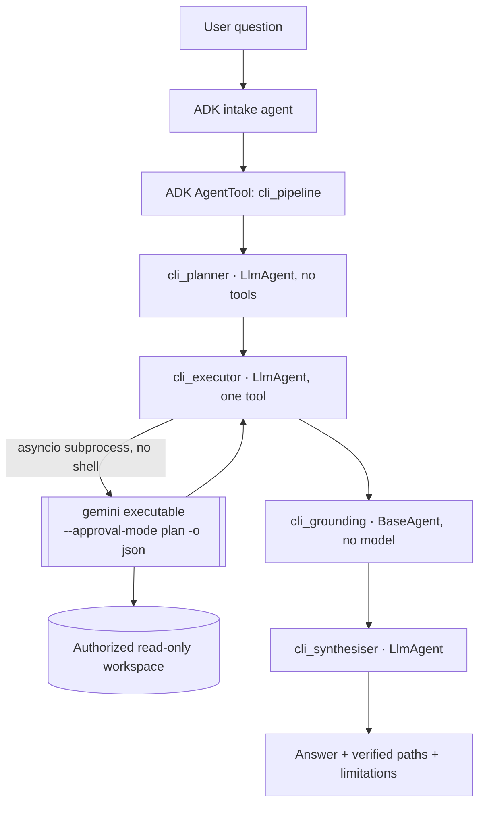

# B — Advanced ADK agent with Gemini CLI as a tool

Answer questions about an authorized read-only directory by having an ADK pipeline
plan the work, a separate **real `gemini` process** inspect the files, and a
deterministic stage verify that the paths the CLI named actually exist.

**B1 and B2 are PASSED and live-verified.** The CLI is the pinned
`@google/gemini-cli` 0.65.0 executable, invoked as a subprocess, authenticated against
Vertex AI. Parts C, D and E of this repository are the responsibility of other work and
are not covered here.



The three stage kinds are deliberately distinct and are labelled in the API response
and the UI: `adk_llm_agent`, `gemini_cli_subprocess`, `adk_deterministic_agent`. That
labelling is the evidence that the ADK planning step and the CLI execution step are
genuinely different things rather than one model call described as two.

## Components and versions

| Piece | What it is |
|---|---|
| `@google/gemini-cli` 0.65.0 | Real executable, pinned in `infra/gemini-cli` with a lockfile |
| Node 24.22.1 | Enforced by `scripts/check-node`; the CLI declares `node >=20` |
| `cli.py` | `asyncio.create_subprocess_exec` adapter: no shell, allowlisted env, limits |
| `grounding.py` | Deterministic path verification; runs no model |
| `agent.py` | `SequentialAgent` of planner, executor, verifier, synthesiser |
| Vertex AI | `GOOGLE_GENAI_USE_VERTEXAI=TRUE` + ADC, so usage bills Cloud credits |

## Setup

```sh
make setup-gemini-cli        # installs the pinned CLI, prints its --version
./scripts/stage-cli-workspace # stages real source outside the repo, prints the path
# put that path in GEMINI_WORKSPACE in the local root .env
make preflight-cli           # version + backend + workspace, no model call
make verify-cli              # one real CLI invocation
make verify-cli-pipeline     # the full ADK pipeline, writes docs/evidence/
make run-api && make run-web # the authenticated UI
```

`nvm use 24.22.1` first; `make typecheck` fails with `BLOCKED_NODE_VERSION` otherwise.

## Why the workspace is staged outside the repository

Gemini CLI 0.65.0 loads a project `.env` from its working directory **and every
ancestor directory**, and a trusted workspace loads every variable in it. That was
verified, not assumed: a `GOOGLE_API_KEY` placed in a parent directory overrode the
Vertex credentials passed in the child environment. Any directory inside this
repository is therefore unusable, because the local root `.env` sits above it.

`resolve_workspace` refuses a workspace that holds a credential file anywhere in its
subtree or has a `.env` in any ancestor. `scripts/stage-cli-workspace` copies
`packages`, `api` and `scripts` into `~/.cache/adk-suite/cli-workspace` and refuses to
stage if a credential file would be copied. The CLI inspects real project source.

## HTTP interface

`POST /api/agents/gemini_cli_tool/{session_id}/inspect`, authenticated, body
`{"question": "..."}` with 10–2000 characters. Ownership is derived server-side, so
another identity receives `404`. Invalid or unexpected fields are `422` before any
subprocess starts. A provider refusal is `503`; a pipeline failure is `502`.

The response carries the answer, the deterministic grounding verdict, the plan, the
labelled stages, and the sanitized invocation record: executable, argv with the task
redacted to `<task>`, workspace, exit code, duration, CLI session id and stats.

## Example questions

- Which modules define the HTTP routes and the session persistence, and how do they relate?
- How does this project load configuration and authenticate requests?
- What validation happens before an external provider is called?

## Security

Read-only by default: `--approval-mode plan` is fixed in code and not settable from a
request; `--yolo` is never passed. The task is a single `-p` argument and no shell is
involved, so injection text survives as one inert argv element — there is a test for
exactly that. The child environment is an allowlist that excludes `GOOGLE_API_KEY` and
`GEMINI_API_KEY`, because the CLI prefers a key over Vertex credentials and with a
stray key present it billed an unrelated project. Timeout kills the whole process
group. Output is capped. Untrusted-folder exit 55 is reported, not worked around,
because in that state the CLI silently downgrades the read-only approval mode.

## Verification status

`implemented`, `tested locally` and `live-service verified`. Not `cloud-deployed`.

- 56 unit tests for this part; 112 across the repository.
- `docs/evidence/b1-cli-gate.txt`: `gemini_cli_version=0.65.0`, exit 0.
- `docs/evidence/b2-pipeline-run.json` and `docs/evidence/b2-api-e2e.txt`: a real run
  through the authenticated API, 200 in 107s, CLI exit 0 in 82s, five paths verified
  present, one named path absent and the dependent claim dropped.

Known limitation: grounding verifies that named paths exist, not that statements about
file contents are accurate. The reports say so rather than implying more.

YouTube video URL:
