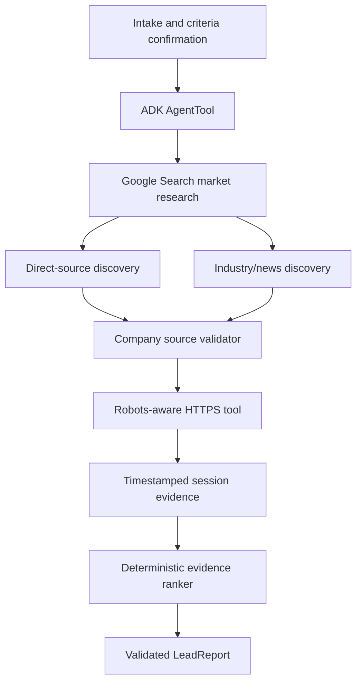

# A — Deep research lead generation

Investigate prospective companies through live Google Search and direct public
sources, returning only leads whose cited excerpt appears in a page this service
fetched and hashed itself.

**A1 and A2 are PASSED and live-verified** on Vertex AI (`gemini-3.6-flash`,
`location=global`). `make integration-lead` passes, and a real query through the
authenticated API returned two Ohio machine shops with digest-pinned citations plus
a CSV matching every displayed value. Three further candidates were reported
unverified with specific reasons rather than dropped. Evidence is under
`../../docs/evidence/`. Parts B–E have not been started.



## Setup and execution

From the repository root, `make setup`. Fill root `.env` with GOOGLE_API_KEY and
GEMINI_MODEL. List the models a key may use with the Gemini API `models` endpoint
rather than assuming one: `gemini-2.5-flash` and `gemini-2.5-pro` now return 404
"no longer available to new users" for keys created recently. Grounding entitlement
is separate from model availability and must be proved with `make probe-lead`.
Keep `agents/lead_research/.env` private; this component inherits root settings.

```sh
make preflight-lead     # configuration only, no provider call
make probe-lead         # real call: reports generation and grounding capability
make verify-lead        # one real query; writes docs/evidence/a1-live-grounded-run.json
make integration-lead   # live-marked gate assertions
make run-adk            # ADK web developer UI on 127.0.0.1:8001
```

For the authenticated application, run `make run-api` and `make run-web`, open the
Vite URL, choose **Deep research lead generation**, paste your `LOCAL_ACCESS_TOKEN`,
create a session, then fill the criteria form. The form requires an explicit
confirmation step before anything is sent, because each run issues real billable
search queries.

## HTTP interface

| Method | Path | Purpose |
|---|---|---|
| `GET` | `/api/readiness` | Per-provider configuration state. Never reports entitlement. |
| `POST` | `/api/sessions` | Create a persistent ADK session owned by the caller. |
| `POST` | `/api/agents/lead_research/{session_id}/research` | Run the pipeline in that session. |
| `GET` | `/api/agents/lead_research/{session_id}/export.csv` | CSV of the persisted report. |

Every agent path requires a bearer credential and resolves the owner server-side, so
a session identifier alone grants nothing: another identity receives `404`. The
request body is the `ResearchRequest` schema, rejected with `422` before any billable
call if criteria are missing or out of range. A provider refusal returns `503` with
the `BLOCKED_PROVIDER_QUOTA` guidance rather than an empty report, so an outage can
never be mistaken for "no leads found". Exporting before a run returns `409`, not an
empty file.

The CSV is rendered from the report persisted in session state, which is the same
object the UI received, so the two cannot drift apart. An end-to-end check asserts
that row for row.

Open http://127.0.0.1:8001 and select lead_research. ADK Web is an unauthenticated
local developer tool: the command binds to loopback. The shared authenticated
React UI currently exposes session/readiness verification only. Its research
form, validated report rendering and CSV download belong to gate A2.

Example user inputs (not results):

- Find 3 industrial robotics companies in California selling to small manufacturers.
- Find 5 renewable-energy companies in Germany with publicly documented expansion.
- Find 3 cybersecurity software vendors in Canada serving healthcare organizations.

The intake agent requests missing criteria and confirmation before dispatching
research. `ResearchRequest` requires industry, region, buyer_profile and quantity
(1–10), with optional exclusions. Its JSON schema is generated by Pydantic and
used as the ADK pipeline tool input. `Citation`, `Lead`, `LeadReport` and `SourcePage`
are typed contracts.

## Scoring rubric

`ranking.py` runs after the model stages and is not itself a model. A candidate is
kept only when a cited excerpt appears verbatim in the page actually retrieved for
that URL *and* the page names the company. Surviving citations have their digest and
timestamp replaced with the observed values, so a model cannot assert a digest.
Score starts at 40 for having any verified citation, adds 30 when a citation comes
from the company's own normalised domain, and adds 20 when more than one distinct
host corroborates it. Confidence is `high` only when both conditions hold.
Organisations are deduplicated by IDNA-normalised domain, keeping the better-scored
entry, and the report is ordered by descending score then domain. The score measures
source completeness, not commercial suitability, and the report says so.

## Implementation and observed verification

AgentTool wraps a SequentialAgent with a market stage, two ParallelAgent discovery
branches and a validator. Each search specialist has only Google Search as a tool.
The validator's function tool fetches actual sites and stores observed evidence
in ADK state. Template agents remain supported in pinned ADK 2.13.0; they are used
because this pipeline is called as an LlmAgent tool, while Workflow cannot yet be
an LlmAgent sub-agent. Deprecation warnings remain visible.

`make check` includes the architecture, ranking, schema and URL-security tests and
exits 0 with 30 unit tests. The actual ADK AgentLoader successfully loaded
root_agent. A direct Python.org fetch succeeded; see
[evidence](../../docs/evidence/lead-source-retrieval.json). That proves the retrieval
adapter, not lead generation.

Observed provider behaviour: plain generation on the configured model returns 200,
while the same key and model return `429 RESOURCE_EXHAUSTED` whenever the built-in
`google_search` tool is attached. Reproduced on three models, so it is an account
grounding quota, not a model-name error. See
[probe](../../docs/evidence/a1-provider-probe.txt) and
[live gate](../../docs/evidence/a1-live-gate.txt). Model calls are configured with
`HttpRetryOptions` retrying 429/500/502/503/504 six times with exponential backoff
and jitter; the quota survived that, and the pipeline then raises
`BLOCKED_PROVIDER_QUOTA` instead of returning a partial or substituted result. Plain
calls also intermittently return 503 UNAVAILABLE, which the retry absorbs.

Source retrieval validates HTTPS, DNS answers and redirect origins, connects to
the validated IP with hostname-verified TLS, checks robots.txt, excludes scripts,
bounds response bytes and uses limited transient retries. Fetches are serialized
with a one-second interval and a 15-call session budget. Long crawl delays and
uncertain robots responses fail closed. Retrieval does not prove semantic claims.
Socket work uses a worker thread; cancellation does not forcibly terminate that
thread, though network reads have timeouts and size/deadline bounds. DNS resolver
latency still depends on the operating system. No production claim is made.

Search/model usage may incur provider charges. Grounding metadata and required
Google Search suggestion rendering must be verified in A2 before the shared UI
can show production search results. No private contact mining or mutations exist.

YouTube video URL:
